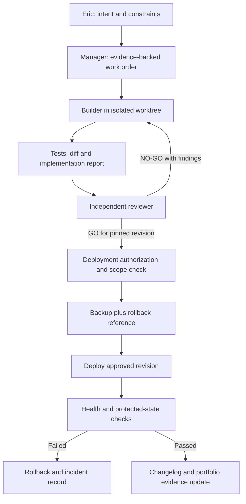

# Human-supervised agent delivery pipeline

## Operating model

Eric asked agents to build the systems and directed fixes when processes broke or results were unsatisfactory. He owned requirements, QC and acceptance. Eric supplies domain intent, accepts tradeoffs, reviews uncertain behavior, and controls publication and consequential changes. Specialized Grok Bot managers coordinate bounded work. Cursor coding agents implement and independent reviewers evaluate. The system is human-supervised, not a proven fully autonomous organization. (Based on private deployment and independent review records, agent work histories and coordination records.)

## Roles

- Engineering manager: decomposes work, tracks blockers, prevents duplicate implementation, maintains shared rules.
- Annotation manager: assigns poles, checks identity and persistence, escalates uncertainty, unsticks a blocked engineer, then hands work back.
- Builder: changes the implementation and adds regression coverage in a bounded workspace.
- Independent reviewer: checks actual diffs, domain semantics, edge cases, protected boundaries and test evidence; can refuse release.
- General Manager: owns company website, branding, operating coordination and publication preparation.
- Specialist support: sales drafts, SEO audits, social drafts, pitch material and invoice coordination. Their existence does not establish autonomous authority to send, publish or spend.

The historical fleet used shared briefs, explicit assignments, STOP/HOLD/GO signals, blocker logs and durable handoffs. Operational lessons include stale instructions, leftover actions, duplicated work and confusing tool success with persisted application state.

## Rule governance

A domain decision is not a general adoption of an entire QC set. Authorized wording, scope, tests, review and any release evidence are recorded so later work can be checked against what was actually accepted. A change log complements the current rules. Neither a fluent model explanation nor a green suite substitutes for an independent semantic review.

## Release discipline

GO applies to a pinned revision and scope. A new corrective commit needs review again; a prior GO cannot be inherited indiscriminately. Text-only exceptions existed historically, but must not be stretched to behavioral changes.

Back up first, preserve protected settings/ledgers, record baseline, deploy only the authorized revision, check service health and output invariants, then record results. A public documentation update is a separate approval from a private local commit.

## Agent infrastructure

A local worker machine supports reusable builder/reviewer launchers and durable run logs. Actual model initialization metadata matters: a requested label alone is not proof of the model used. This package contains no identities, credentials, launcher paths or access details.

## Living documentation hooks

On a completed release, review verdict, evaluation, or QC intake: update the relevant architecture and case-study documents, inspect the diff, and commit locally. The maintenance process remains private. A proposed ongoing process is documented; no new background scheduler has been created by this package.
