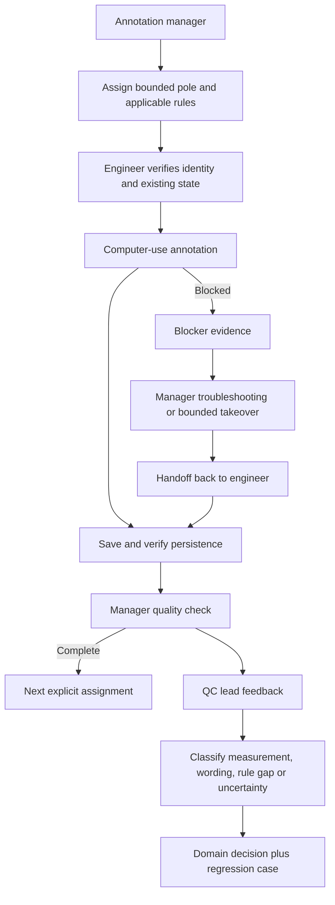
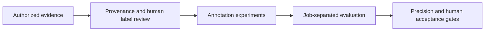

# Annotation operations and Sky Forge R&D

## Human-supervised annotation workflow

Eric asked AI agents to build and refine this workflow, directed fixes when behavior failed, and owned requirements, QC and acceptance. The annotation manager divides work into bounded pole assignments for engineer bots. Each assignment needs identity evidence, the applicable rules, job-specific exceptions and a stop condition. The manager troubleshoots genuine blockers, takes over only as needed, then hands the pole back rather than becoming the permanent annotator. (Based on private agent work histories and coordination records.)

## Computer-use operation

Agents operate the annotation UI under human review; uncertain or blocked work goes to a person rather than being guessed.

## QC-reviewed job example

A QC lead edited measurements and note wording on a reviewed job. The comparison separated four things: unchanged output, output explained by a measurement correction, wording-only differences, and substantive rule disagreements. A reviewed example exposed an output-scope error; independent review rejected incomplete corrections. Proprietary rule behavior is withheld.

## Sky Forge R&D workflow

A separate read-only preview was observed behind an access gateway; it is not an autonomous production annotator. Internal capture, feature construction and geometry algorithms stay private. Permission, provenance, retention and untouched test jobs remain essential controls.
