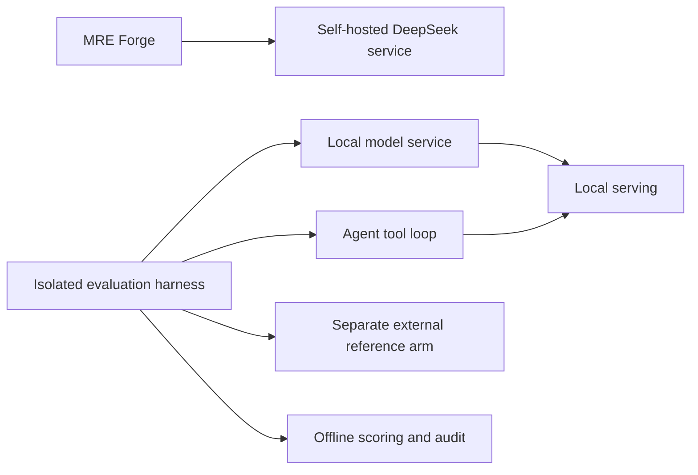

# Local inference and model evaluation

Eric directed the agent-assisted setup, evaluations and fixes; he owned requirements, QC and acceptance, not sole manual implementation.

## Update, November 9, 2026: self-hosted DeepSeek in production

Since November 8, 2026, MRE Forge's local rules model has been a self-hosted DeepSeek model served across two local machines; a Nemotron model was the earlier production setup. Serving parameters, addresses, hardware identifiers and configuration are intentionally omitted.

In a small coding head-to-head against Grok 4.7 on November 9, both arms missed the same multi-file task on the first attempt. The DeepSeek arm was allowed one test-feedback retry; the Grok arm had one attempt. DeepSeek was faster on small edits and slower on long tasks. Both agents read hidden tests on some tasks, so those tasks are contaminated for both arms. This is one small trial, not evidence of general parity. A stricter follow-up head-to-head (same information, same time limit, one attempt each, behavior-only grading with blind review) was in progress as of November 9, 2026; its results are not reported here.

## Architecture

Two local machines serve the local model. Before November 8, production ran a Nemotron model on a single node; later comparisons include that earlier baseline. Two computers do not automatically behave as one pooled GPU.

Specific fabric measurements, serving parameters and hardware identifiers are omitted.

## Methodology

Separate model roles before scoring: rule mapping, code editing, exception review and vision labeling are different tasks. Compare raw endpoint behavior and full agent behavior separately. Preserve fixtures and hidden checks; use independent scoring; record invalid infrastructure runs; distinguish valid JSON from semantic correctness.

Recorded evaluation dimensions included model-identity checks, structured-output behavior, coding artifacts with hidden checks, rule-mapping and review subsets, throughput and memory, and per-run outages or restorations. Exact counts, model version strings and measured rates are withheld from this public copy.

## Selected recorded results

A documented comparison of several local models and a hosted Grok reference was recorded, including coding-artifact and rule-mapping checks. Local and reference arms used different harnesses and time limits, so the results are not an unrestricted ranking or a claim of general intelligence parity. Grading a result at a harness timeout is not the same as a clean completion. Throughput figures are omitted here because different tokenizers, contexts, harness overhead and sampling prevent an unrestricted hardware ranking. External CLI timing is not raw endpoint first-token timing.

## Selective routing experiment

A separate experimental pipeline evaluated retrieval, validation and selective escalation. Proprietary prompts, routing criteria and implementation are withheld.

The routed arm sent a share of cases to an external model. That share is a call-count statistic, not measured monetary savings. Relative to a validated local baseline, routing improved some exact-match counts but also increased some unsafe outputs, and agreement on a held-out review subset did not improve. Time limits and prompts changed together, so fewer timeouts in a newer arm is not an isolated reliability improvement. Valid final JSON is accepted pipeline output, not proof of native constrained decoding or semantic safety.

**Decision: do not replace production based on this experiment.** It remained isolated, without production routing changes.

## Boundaries and rejected claims

- Post-hoc JSON/schema validation is not native constrained decoding.
- An internal-only experimental drafter was not treated as a production-eligible deployment.
- A local-provider arm in the documented Cursor CLI was marked not applicable, not silently replaced with a hosted model.
- Memory monitoring and model restoration are part of the experiment, not optional housekeeping.
- Longer-context and harder coding follow-ups were not established as complete as of November 8, 2026.

Review the evaluation-integrity case study and the underlying private evaluation records before reusing any number.
