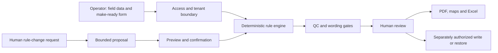

# MRE Forge architecture

## Scope, users and contribution

MRE Forge is a human-supervised telecom engineering workflow serving a regional engineering client. It converts structured field measurements and the client's make-ready form into reviewable notes, QC findings and downloadable deliverables. It is not unrestricted photo-to-engineering generation. (Based on company and career materials, application requirements, service observations, and deployment and review records.)

Eric asked AI coding agents to build the systems and directed fixes when processes broke or results were not satisfactory. He owned requirements, domain decisions, QC and acceptance; implementation was agent-assisted, not a claim of personal manual code authorship.

## User workflow

1. Select the job and saved configuration; supply structured field data and the client's make-ready form.
2. Review input matching and QC findings. Missing, contradictory or unmatched evidence is held for a person rather than guessed.
3. Generate notes using the deterministic rule engine. Inspect notes and unresolved findings before accepting the run.
4. Download the make-ready form PDF, KML/KMZ and Excel deliverables from the same reviewed run.
5. Request a rule change in natural language if needed. The system may offer clarification or a bounded proposal for human review, with a before/after preview and confirmation. A proposal does not authorize production changes or external writes.
6. Keep external write and restore actions separately authorized. Review their scope, current-state conflicts and verification results; do not assume every upstream side effect is perfectly reversible.

## High-level system boundaries

Backend implementation stays generic: proprietary rules, predicates, thresholds, formulas, templates, source layout and executable examples are not publication material. Authentication, tenant separation and gated actions are observed controls, not a security certification or comprehensive audit.

## Review and release loops

Eric sets requirements and acceptance criteria, directs agent builders, and redirects fixes when behavior is unsatisfactory. Independent reviewers can return NO-GO even when tests pass. A change goes through regression checks, independent GO, backup/rollback preparation and separately authorized deployment. A new revision needs fresh review coverage.

A release requires an independent GO and passing output gates; test results are revision-specific and are not proof of universal correctness. Running service evidence does not establish uptime.

## Publication boundary

Describe inputs, outputs, user operation, gates, review loops and outcomes in depth. Public exports contain cleared docs, high-level diagrams and outcomes only: no rule engine, proprietary logic or copyable implementation. Demos are approved video/screenshots only, never runnable code. Private source/history and local sanitization/blur utilities are excluded.
