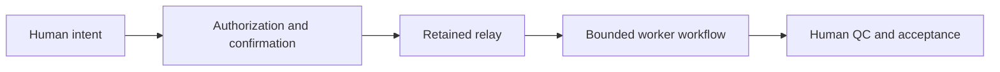

# Retained OpenClaw-era remote-ops relay

## Findings and limits

Read-only inspection established retained OpenClaw-era relay components on a local worker machine. The relay is owner-only, every command needs confirmation, and requests expire. End-to-end annotation execution through the relay was not established in that check; process presence is not proof of operational reliability. (Based on read-only relay inventory checks and private historical records.)

No official NVIDIA NemoClaw/OpenShell installation was verified; helper names alone do not establish that runtime. Second-machine findings remain separately qualified; lack of verification is not proof of absence everywhere.

## High-level operational boundary

This diagram describes intended boundaries, not verified end-to-end execution. No security certification is claimed.

## Eric's contribution

Eric asked agents to build the workflow, taught annotation procedures, directed corrections when processes broke or results were unsatisfactory, and owned requirements, QC and acceptance. He directed retention of the relay components after framework removal. This is supervised agent-assisted development, not personal manual authorship of the relay or OpenClaw itself.

## Publication boundary

Describe the role of the relay, human authority, review loops and limitations. Source filenames, command syntax, protocol details, configuration, prompts and executable examples stay out of public copy. No commands, browser actions, service restarts or model operations were performed for this documentation.
