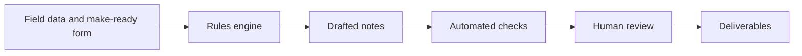

# Case study: reliable AI-assisted telecom engineering workflows

## Problem

Telecom engineering involves converting structured field measurements and supporting documents into precisely worded notes, QC findings and multiple deliverables. Repeated manual transcription creates friction; ambiguous ownership, missing heights and subtle clearance rules make unrestricted text generation inappropriate.

Eric contributed years of domain experience and acted as founder, product architect and AI-assisted implementation coordinator. The record supports requirements, acceptance criteria, rule decisions, agent orchestration, model evaluation and operation. Eric asked AI coding agents to build the systems and directed fixes when processes broke or results were not satisfactory. He owned requirements, domain decisions, QC and acceptance; implementation was agent-assisted, not a claim of personal manual code authorship. (Based on company and career materials, application records, service observations, deployment and independent review records, and agent work histories.)

## Constraints

- No invented measurements, owners, pole matches or engineering rules.
- Exact domain wording and line order.
- Human authority for uncertain or consequential actions.
- Existing field-data platform behavior and mutable upstream state.
- Limited local inference capacity shared with experiments.
- Restricted data and publication permissions.
- Isolation between live service, development and evaluation.

## Approach

Field data and the client's make-ready form go into a rules engine, which drafts the engineering notes. Automated checks run on the draft, and a person reviews and accepts the result before deliverables are produced. Rule changes and any external writes stay behind human confirmation.

See the detailed architecture for components and trust boundaries.

## Alternatives rejected or constrained

1. **Free-form model output as engineering truth:** rejected in the main generation path; deterministic notes remain authoritative.
2. **Promote the fastest local model immediately:** rejected; domain accuracy, unsafe responses, completion behavior and operational constraints matter.
3. **Treat more resolved exceptions as better quality:** rejected when a routing experiment resolved more cases but reduced final agreement.
4. **Deploy a higher-recall detector despite false positives:** held because proposal precision deteriorated.
5. **Treat green tests as complete review:** rejected by repeated independent NO-GO findings.
6. **Adopt all QC edits as ground truth:** not supported; classify measurement, wording and rule disagreements separately.

## Builder-versus-reviewer story

A QC-reviewed example exposed an output that overstated the affected scope. Eric directed agents to correct it and required the result to match domain expectations.

Successive independent reviews found additional edge cases and rejected incomplete fixes. This is a review-and-acceptance story: a green suite did not overrule domain evidence or authorize release. Rule conditions, grouping logic, arithmetic and wording templates are intentionally withheld.

This is a process case study about review and acceptance, not a claim about any specific fix.

## Testing and release

Releases go out only with an independent GO and passing output gates. Tests use fixtures/mocks; they do not prove the live model is intelligent or every external workflow is correct.

Behavioral changes use feature worktrees, regression tests, rulebook/change-log updates and independent review. Deployment preparation includes a backup and rollback reference. Post-release verification checks health and protected-state invariants. No tests or deployments were initiated to prepare these documents.

## Results, with limits

- A working private-access web application produces notes and PDF/KML/KMZ/Excel artifacts.
- A live service and source revision were observed on November 8, 2026.
- A mature set of test, review, backup and rollback artifacts exists.
- Self-hosted local inference (DeepSeek, since November 8, 2026) supports constrained rule interpretation.
- A synthetic walkthrough exists for product explanation.
- No new measured labor-saving percentage, commercial throughput, uptime SLA or revenue claim is asserted here.
- No autonomous photo annotation, official platform partnership or security certification is claimed.

## Lessons

Domain expectations must remain stable across revisions. Independently reviewed counterexamples are as important as unit counts. Format-valid model output can be wrong. Reduced escalation can conceal errors. The safest product architecture assigns narrow authority to models and keeps human control over consequential changes.

## Next steps

Finish QC decisions individually, measure real outcomes on approved data, and publish a separately cleared synthetic walkthrough.
